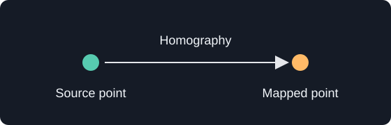

# Review a document together

Edit this Markdown file to see the page update. Select text and choose
**Comment**, or select an equation or figure. **History** contains the saved
threads, replies and explicit resolved/unresolved state.

## A mathematical step

For a point in homogeneous coordinates, the mapping divides by its third
component:

$$
\begin{aligned}
x' &= \frac{h_{11}x+h_{12}y+h_{13}}{h_{31}x+h_{32}y+h_{33}},\\
y' &= \frac{h_{21}x+h_{22}y+h_{23}}{h_{31}x+h_{32}y+h_{33}}.
\end{aligned}
\tag{1}
$$

The equation describes the point mapping. The figure below distinguishes the
source point from its mapped point.

A useful qualification

Local rendering and GitHub rendering use different pipelines. Check the
destination renderer before publishing a mathematical explanation.

## Keyboard review

Use `j`/`k` to move, `v` to select, and `c` to comment on the selection.
The `-h` shortcut opens history. Textareas retain native keyboard behavior.
