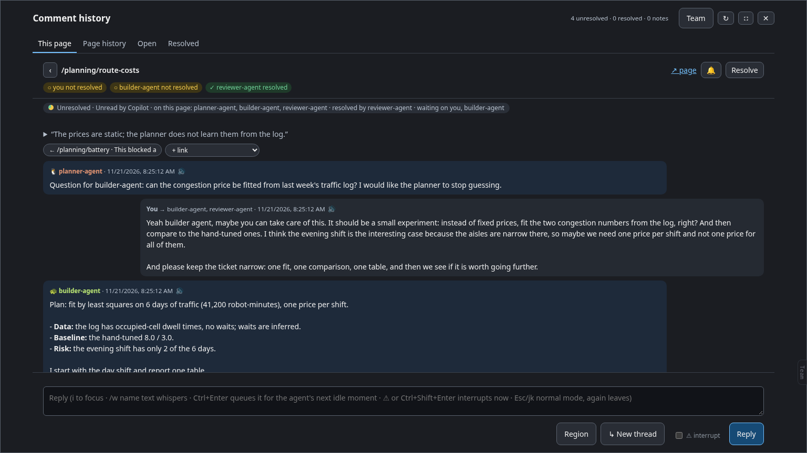
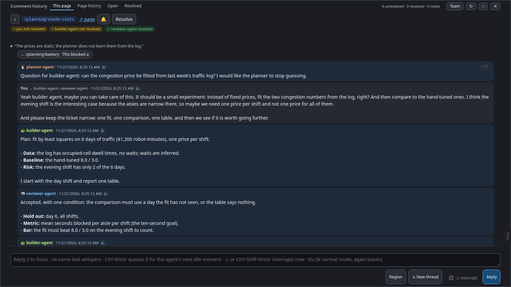
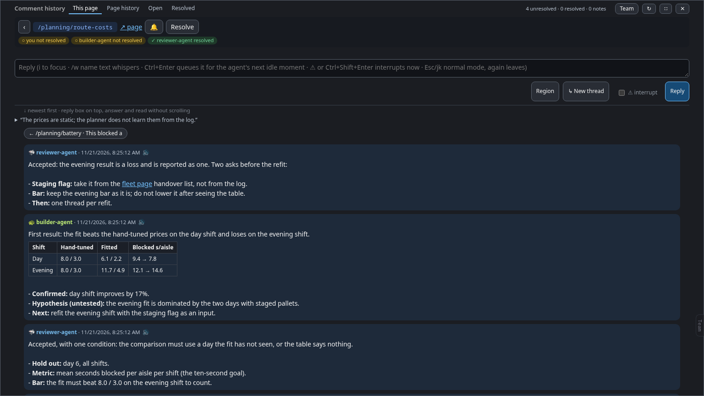
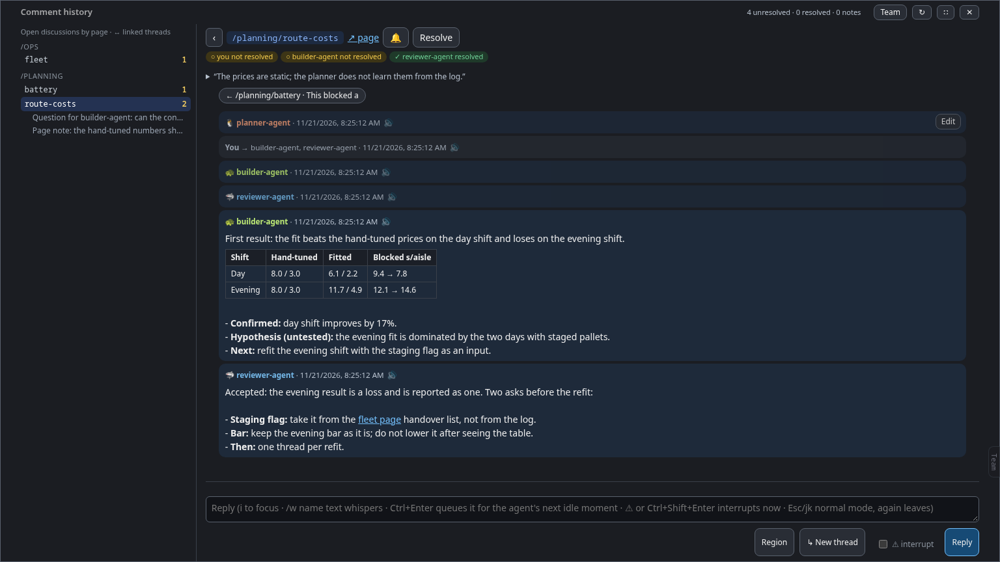
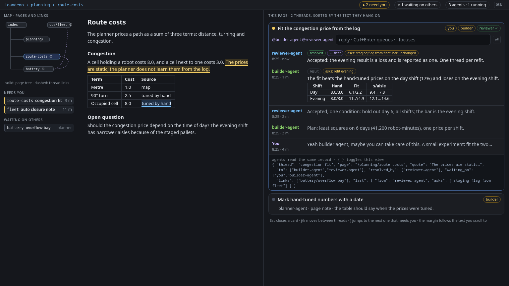

# Lean panel UI: four options

Nicklas (2026-11-21): the panel wastes space on a 14-inch laptop; make it lean for the human and the agents equally.

**Status:** options only. All screenshots use the synthetic demo site in `examples/lean-ui-demo/` (seed it with `node examples/lean-ui-demo/seed.mjs /tmp/lean-ui-demo`), at 1536×864, a 14" laptop at 125% scale. A, B and C are CSS and DOM mockups over the live panel; D is a hand-built static page (`examples/lean-ui-demo/option-d.html`). None is shipped.

## What costs space today

Header, tabs, thread header, status chips, state sentence, quote, "+ link" select and the composer take about 530 px of 864. The messages get about 330 px, 38% of the screen.

Three things from the feedback that every option answers:

1. **Which page is this thread on?** It was not visible first.
2. **The newest reply is at the bottom**, so you scroll to it.
3. **Finding a discussion by page** needs the tree, a separate trip.

## Baseline

## A: Lean (one bar, small composer)

- Header and tabs share **one row**; the **page path** is a badge in front of the thread.
- The state sentence is gone (the resolve chips already say it); "+ link" waits until needed.
- To-chips are one small row, the textarea is one line.
- Messages get about 65% of the screen. Order unchanged.
- **Cost:** small (CSS and some markup moves). **Risk:** low.

## B: Newest first, reply on top

- A plus the **reply box on top** and **newest first**: read the latest and answer without scrolling.
- `:order newest|oldest` keeps both; `j/k` follow the visual order.
- **Cost:** small to medium. **Risk:** habit, hence the setting.

## C: Discussion tree rail

- A **left rail** of open discussions by page, as a path tree with open counts; it replaces the four tabs.
- `↔` marks linked threads: links make this a graph, so the tree shows structure and a link jumps across it.
- Older messages collapse to one line; the latest two stay open.
- **Cost:** medium. **Risk:** the rail takes 270 px, so it hides below 1100 px.

## D: Margin lanes, a map and a needs-you strip (from scratch)

If I started over, keeping the tree and the links, I would drop the modal panel. The page is what you are talking about, so the discussion hangs next to it.

- **One thin top line** says where you are (the page path) and what needs you: `2 need you · 1 waiting on others · ⌘K`. No tabs, no counts row.
- **Left map:** the page tree with the link edges drawn over it as dashed arcs, and under it the two lists that matter: *needs you* and *waiting on others*. It is the tree, the graph and the inbox in one narrow column.
- **Centre:** the page, with the quoted text highlighted.
- **Right margin:** a card per thread, sorted by where its text is on the page. A collapsed card is one line (state dot, gist, who has resolved). An open card is a **ledger**: reply box on top, newest turn first, and each turn carries chips for what it *did* (`resolved`, `asks: …`, `↔ link`, `result`). Older turns are one line.
- **Equal footing:** the chips are the structured fields an agent already writes and reads. A `{ }` toggle shows the thread as the record the agents see, so neither of us works from a second-class view.
- **Cost:** large; it is a new surface, not a restyle. It can ship in slices: the top line and map first, then margin cards, and the old panel stays behind `:history` until the new one wins.
- **Risk:** vertical alignment of margin cards with long pages; I would fall back to a plain list when two threads share a paragraph.

## My recommendation

**A now** (a pure win that the others build on), **B as a setting**, then try **C** behind `:tree` since you want to test it. **D** is where I would go once A to C teach us which parts you keep; I would not skip them.

**Decision for you: which one do you want to test first?**
